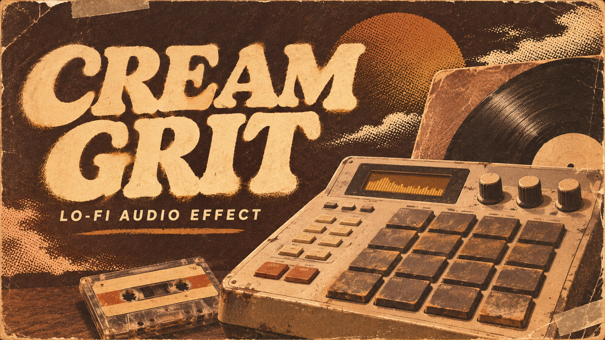

# drumlogue backport — v0.7.0 preview 1

[Release・ダウンロード](https://github.com/ufotone/Cream-Grit/releases/tag/v0.7.0-preview.1) · [English](#english)

VST版 [PR #1](https://github.com/ufotone/Cream-Grit/pull/1) のSAMPLE、COMP、RINGをdrumlogueへ逆移植した試作版です。ベースは `811ec04729a62a0aeabdc64d76971f4ead2d35ab`。本体での動作・CPU負荷は未確認です。

## 本体での設定

| 項目 | 今回の仕様 |
|---|---|
| P-MODE | DRUM（従来方式） / SAMPLE。CLEANなし。初期値DRUM |
| P-SCOPE | HIGH固定。SPLIT以下の低域をピッチ処理から保護 |
| COMP | 0–100%、初期値0。ステレオ連動の全帯域コンプレッサー |
| RING | OFF / ON。ON時は量50%、周波数230 Hz固定。初期値OFF |
| CHORUS（MASTER） | OFF / ON。ON時は量30%、0.8 Hz、深さ50%固定 |
| REVERB（MASTER） | 量0–100%を調整可能。0で休止 |
| R-DECAY（MASTER） | 従来どおり0.3–8.0秒を調整可能 |
| R-DAMP（MASTER） | 60%固定 |

MASTERは23項目、DELAYは17項目です。MASTERのPAN / P-RATE / P-WAVEは引き続き調整できます。CHORUSの量30%は、既存Wide Spaceの20%より少し強めの出発点として選びました。聴感での実機調整は今後必要です。

SAMPLEは22 msの短いグレイン、補間しない読み出し、仮想再生クロックでのサンプル保持を使います。CLOCKとPITCHが保持クロックへ作用します。PITCH=0またはP-MIX=0では、従来と同じくピッチ段全体が休止し、SAMPLEの質感も掛かりません。HIGH固定のため、SAMPLEも低域を直接ピッチ処理しません。COMPとRINGは全帯域に作用します。

最初はP-MODE=SAMPLE、PITCH=-12、P-MIX=100、COMP=40程度で確認できます。CLOCKを下げるとSAMPLEの保持感も変わります。CHORUS・REVERB・RINGは個別に加えてください。

## 導入と保存済み設定

- MASTER：`cream_grit_master.drmlgunit` を `Units/MasterFXs/` へ。
- DELAY：`cream_grit.drmlgunit` を `Units/DelayFXs/` へ。
- 本体の表示名とunit IDは従来版と同じです。同じスロットの従来版を置き換えます。
- **パラメーターの位置が変わっています。旧プログラムのFX設定値は互換ではありません。** 旧版の設定を控え、導入後は内蔵FXプリセットを読み直してから調整・保存してください。
- 12bit / Down DirtはCOMP・RING・CHORUS・REVERBをOFF。Wide Space / Random DriftはCHORUS=ON、REVERB量18%。全プリセットでP-MODE=DRUMです。
- firmware 1.00以上 / SDK API 2.0、48 kHzを前提とします。

## 負荷と制約

[公式SDK](https://github.com/korginc/logue-sdk/blob/master/platform/drumlogue/common/runtime.h) の公開パラメーター上限は24項目です。固定化とON/OFF化で上限内に収めています。公開SDKから、このFXに保証されるCPU時間・RAM容量の数値は確認できていません。ビルド成功やPC上の処理速度から、実機での余裕を保証することはできません。

- 既存の8192フレーム・ステレオint16ピッチバッファを共用。音声バッファの追加なし。
- MASTER音声バッファ合計150,084 bytes、DELAYは128,772 bytesで従来と同じ。
- DSPオブジェクトの増加は72 bytes（MSVC x64測定）。MASTER 150,816 bytes、DELAY 129,232 bytes。ラッパーやヘッダーは別です。
- 最終ARMビルドのセクション容量は下表。ELFファイル容量と実行時RAM使用量は別です。

| ビルド | text | data | bss |
|---|---:|---:|---:|
| MASTER | 17,742 | 372 | 151,060 |
| DELAY | 12,110 | 372 | 129,404 |

COMPの包絡追従は48 kHz、log/powを伴うゲイン計算は4サンプルごと（12 kHz）です。RINGのsinは多項式近似を使います。VSTと完全一致する設計ではありません。COMP/RINGを最大にしたトランジェント入力では、VSTとの差は相対RMSで約−47.4 dB、最大絶対差0.0303でした。この値は当該テスト信号に対する結果です。

OFF後は短い平滑化を経てCOMP/RINGを休止します。コーラス・リバーブ・ディレイも量0で休止します。オーディオ処理中の動的メモリ確保はありません。

## 確認済み

- logue-sdk ARMv7 / Cortex-A7ターゲットでMASTER / DELAYをビルド。
- 同じ設定で新機能をOFFにした従来DSPと旧DSPがサンプル単位で完全一致。
- SAMPLEが48 kHzのVST実装とサンプル単位で完全一致。
- ピッチ・CLOCKの端点、モード変更、最大COMP/RING/空間系で有限値・出力上限を確認。
- パラメーター対応、範囲制限、固定値、ON/OFF、プリセット、reset、ブロック長の独立性。
- MASTERの4入力→2出力、2入力互換、インプレース動作、サイドチェーン非混入。
- 既存の基本DSP・空間系・APIテストとVST null test（両版）を実行。
- 生成したELFのヘッダーを読み、版番号・項目数・項目順・ON/OFF範囲を確認。

実機では、SAMPLE＋COMP＋RING＋CHORUS＋REVERBをONにし、内蔵音源を多く鳴らした状態で途切れ・ノイズ・操作時の応答を確認してください。連続運転や本体の負荷計測は未実施です。

## テスト用旧版

`tests/reference/src/` は移植前DSPの固定コピーです。namespaceだけを `creamref` に変更しています。VST null testもこのコピーを参照し、移植で変更される本体DSPを比較基準にしないようにしています。ライセンスはリポジトリーと同じです。

ビルド手順は `BUILD.md` を参照してください。ビルドログは配布フォルダーの `build-master.log` と `build-delay.log` にあります。

## English

This preview backports SAMPLE, COMP and RING from the [VST port, PR #1](https://github.com/ufotone/Cream-Grit/pull/1), based on commit `811ec04729a62a0aeabdc64d76971f4ead2d35ab`. **Hardware operation and CPU headroom have not been tested.**

[Release and downloads](https://github.com/ufotone/Cream-Grit/releases/tag/v0.7.0-preview.1)

### Hardware controls

| Control | Preview behavior |
|---|---|
| P-MODE | DRUM (original) / SAMPLE; no CLEAN; defaults to DRUM |
| P-SCOPE | Fixed to HIGH; protects bass below SPLIT from pitch processing |
| COMP | 0–100%; defaults to 0; stereo-linked full-band compression |
| RING | OFF / ON; ON fixes amount to 50% and frequency to 230 Hz; defaults to OFF |
| CHORUS (MASTER) | OFF / ON; ON fixes amount to 30%, rate to 0.8 Hz and depth to 50% |
| REVERB (MASTER) | Adjustable 0–100%; zero suspends processing |
| R-DECAY (MASTER) | Adjustable 0.3–8.0 seconds, as before |
| R-DAMP (MASTER) | Fixed to 60% |

MASTER exposes 23 controls; DELAY exposes 17. MASTER PAN / P-RATE / P-WAVE remain adjustable. The 30% chorus amount is a starting point slightly stronger than the previous Wide Space setting of 20%; listening and tuning on hardware are still needed.

SAMPLE uses short 22 ms grains, non-interpolated reads and sample holding at a virtual playback clock. CLOCK and PITCH affect that hold clock. PITCH=0 or P-MIX=0 suspends the entire pitch stage, including the SAMPLE texture. With HIGH fixed, SAMPLE does not directly pitch-shift the bass. COMP and RING affect the full band.

Try P-MODE=SAMPLE, PITCH=-12, P-MIX=100 and COMP around 40. Lowering CLOCK also changes the hold texture. Add CHORUS, REVERB and RING individually.

### Installation and saved settings

- MASTER: copy `cream_grit_master.drmlgunit` to `Units/MasterFXs/`.
- DELAY: copy `cream_grit.drmlgunit` to `Units/DelayFXs/`.
- Display names and unit IDs are unchanged; each replaces the previous edition in the same slot.
- **Parameter positions have changed. Saved FX settings in older programs are incompatible.** Record your previous settings, reload a built-in FX preset after installation, then adjust and save again.
- 12bit / Down Dirt disable COMP, RING, CHORUS and REVERB. Wide Space / Random Drift enable CHORUS and set REVERB to 18%. All presets use P-MODE=DRUM.
- Requires firmware 1.00 or later / SDK API 2.0 and 48 kHz audio.

### Load and constraints

The [official SDK](https://github.com/korginc/logue-sdk/blob/master/platform/drumlogue/common/runtime.h) permits up to 24 exposed parameters. Fixed values and toggles keep this preview within that limit. A guaranteed per-effect CPU-time or RAM allowance has not been identified in the public SDK. Successful compilation and desktop timing do not establish hardware headroom.

- Reuses the existing 8192-frame stereo int16 pitch buffer; no added audio buffers.
- Audio buffers remain 150,084 bytes for MASTER and 128,772 bytes for DELAY.
- DSP object size increases by 72 bytes on MSVC x64: MASTER 150,816 bytes; DELAY 129,232 bytes. Wrappers and headers are separate.
- Final ARM section sizes are listed below. ELF file size and runtime RAM usage are different measures.

| Build | text | data | bss |
|---|---:|---:|---:|
| MASTER | 17,742 | 372 | 151,060 |
| DELAY | 12,110 | 372 | 129,404 |

COMP follows its envelope at 48 kHz and calculates log/pow gain every four samples, at 12 kHz. RING uses a polynomial sine approximation. These additions are not designed to be bit-identical to VST. On the transient test input with maximum COMP/RING, the difference from VST was about −47.4 dB relative RMS and 0.0303 maximum absolute error. Those figures apply to that test signal.

COMP and RING suspend after a short smoothing tail when disabled. Chorus, reverb and delay also suspend at zero amount. Audio processing performs no dynamic memory allocation.

### Validation

- Built MASTER and DELAY for logue-sdk ARMv7 / Cortex-A7.
- With identical settings and additions disabled, the original processing matches the previous DSP sample for sample.
- SAMPLE matches the VST implementation sample for sample at 48 kHz.
- Pitch/CLOCK endpoints, mode changes and maximum COMP/RING/spatial effects remain finite and bounded.
- Checked parameter mapping, clamping, fixed values, toggles, presets, reset and callback-size independence.
- Checked MASTER four-input/two-output geometry, stereo compatibility, in-place processing and absence of sidechain leakage.
- Ran existing basic DSP, spatial and API tests, plus VST null tests for both editions.
- Read the generated ELF headers to verify versions, parameter counts/order and toggle ranges.

On hardware, test SAMPLE + COMP + RING + CHORUS + REVERB while playing many internal voices, and check for dropouts, noise and control responsiveness. Continuous-operation testing and hardware load measurements have not been performed.

### Frozen reference DSP

`tests/reference/src/` holds the pre-backport DSP with only its namespace changed to `creamref`. VST null tests also use this frozen copy so that the changed hardware DSP is not its own reference. It uses the repository's existing licenses.

See `BUILD.md` for build instructions. The release bundle contains `build-master.log` and `build-delay.log`.
